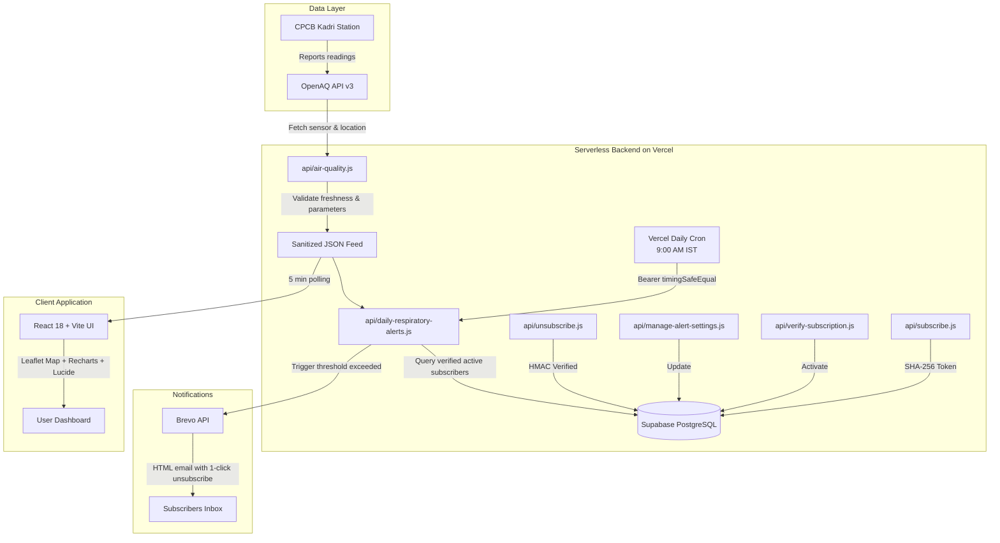

# AirMesh — Urban Air Quality & Daily Respiratory Alert System

[](https://vitejs.dev/)
[](https://react.dev/)
[](https://supabase.com/)
[](https://www.brevo.com/)
[](https://openaq.org/)
[](LICENSE)

**AirMesh** is a full-stack environmental monitoring web application and personalized notification engine. It pulls real-world continuous air pollution measurements from the **Central Pollution Control Board (CPCB)** monitoring station in **Kadri, Mangaluru** via the OpenAQ API, verifies sensor freshness and data integrity, and delivers scheduled daily email alerts to residents when pollutant concentrations exceed their custom respiratory health thresholds.

---

## Architecture Overview



---

## Key Features

### 1. Live Continuous Monitoring
- **Real CPCB Sensor Data**: Connects directly to the Kadri, Mangaluru station (`Location ID: 44513`) via OpenAQ v3.
- **Comprehensive Pollutant Coverage**: Real-time readings for **PM2.5, PM10, Ozone ($O_3$), Nitrogen Dioxide ($NO_2$), Sulphur Dioxide ($SO_2$), Carbon Monoxide ($CO$), Nitric Oxide ($NO$), and Nitrogen Oxides ($NO_x$)**.
- **Meteorological Context**: Ambient temperature, relative humidity, wind speed, and wind direction.

### 2. Strict Data Validation Pipeline
- **Stale Detection**: Measurements older than 24 hours are classified as stale and excluded from live averages.
- **Future Timestamp Protection**: Discards anomalies stamped >5 minutes in the future.
- **Value Sanitization**: Automatically rejects negative, non-numeric, or malformed sensor telemetry.
- **Dynamic Sensor Mapping**: Resolves raw sensor IDs against location parameter definitions to ensure unit and chemical accuracy.

### 3. Configurable Respiratory Alert System
- **Tailored Profiles**: Three operational modes — **Respiratory-sensitive** (starts at WHO reference PM2.5 threshold of 15 µg/m³), **General updates**, or **Custom profile**.
- **Per-Pollutant Thresholds**: Users specify custom numeric limits and units for any tracked pollutant.
- **One Scheduled Daily Check**: Cron runs every morning at 3:30 AM UTC (9:00 AM IST) to evaluate the day's conditions without spamming users.

### 4. Enterprise-Grade Security & Privacy
- **Cryptographic Token Hashing**: Verification and management tokens are generated with 32 bytes of entropy (`crypto.randomBytes`) and stored in Supabase exclusively as **SHA-256 hashes**. Plaintext tokens never touch the database.
- **Timing-Safe Cron Authentication**: Uses `crypto.timingSafeEqual` for Bearer token verification to eliminate timing side-channel attacks.
- **One-Click HMAC Unsubscribe**: Every email contains a cryptographically signed unsubscribe link (`api/unsubscribe?id=...&sig=...`), compliant with modern privacy standards.
- **Sliding-Window Rate Limiting**: All public endpoints (`/api/subscribe`, `/api/request-alert-settings`, etc.) are protected against brute-force and spam abuse.
- **Zero Client-Side Secret Leakage**: Service-role keys and email API tokens remain strictly confined to serverless functions.
- **Strict Row Level Security (RLS)**: Public anonymous access to database tables is disabled; all queries go through backend API routes.

### 5. AirMesh AI Assistant
- **Floating Chat Guide**: Ask questions about AirMesh, pollutants, readings, health guidance, and email alerts from any page.
- **Server-Side Groq Integration**: The Groq API key is used only by the Vercel function and is never included in the frontend bundle.
- **Contextual Live Readings**: Questions about current conditions reuse `/api/air-quality`; current, stale, and invalid measurements remain distinct, and the assistant does not infer an official AQI.

---

## Tech Stack

| Layer | Technology | Purpose |
|---|---|---|
| **Frontend** | React 18.3, Vite 6.4, JavaScript | Responsive single-page application |
| **Styling** | Modern CSS3 & CSS Variables | Cloud, sky & navy environmental theme |
| **Mapping** | Leaflet 1.9 & OpenStreetMap | Interactive location visualization |
| **Charts & Icons** | Recharts 2.15 & Lucide React | Visual analytics and iconography |
| **Serverless API** | Node.js Serverless Functions | Edge-compatible API routes on Vercel |
| **Database** | Supabase (PostgreSQL 15+) | Subscriber store with Row Level Security |
| **Email Service** | Brevo API | Transactional verification & alert emails |
| **AI Assistant** | Groq SDK | Server-side AirMesh Q&A and contextual readings |
| **Data Provider** | OpenAQ API v3 | Central Pollution Control Board (CPCB) feed |
| **Hosting & CI/CD** | Vercel | Production hosting with automated crons |

---

## Project Structure

```
air-mesh/
├── api/                             # Serverless backend API routes
│   ├── _rate-limit.js               # Sliding-window IP rate limiter
│   ├── _lib/send-brevo.js           # Shared Brevo email sender
│   ├── _supabase.js                 # Lazy-initialized Supabase client
│   ├── air-quality.js               # OpenAQ data fetcher & validator
│   ├── ai-assistant.js              # Rate-limited Groq assistant endpoint
│   ├── daily-respiratory-alerts.js  # Scheduled cron evaluator & mailer
│   ├── manage-alert-settings.js     # Token-verified settings loader/saver
│   ├── request-alert-settings.js    # Magic link email dispatcher
│   ├── subscribe.js                 # Subscription handler & verification sender
│   ├── unsubscribe.js               # One-click HMAC signed unsubscribe
│   └── verify-subscription.js       # SHA-256 verification token validator
├── src/                             # Modular React 18 frontend
│   ├── components/                  # Accessible UI components
│   │   ├── Accordion.jsx            # Accessible collapsible panel
│   │   ├── AlertsTab.jsx            # Email alert subscription & settings view
│   │   ├── AIHelper/                 # Floating assistant and chat styling
│   │   ├── GradientWave.jsx         # Ambient CSS wave animation
│   │   ├── HealthTab.jsx            # Health & exposure guidelines
│   │   ├── MapView.jsx              # Leaflet station map with Vite asset fix
│   │   ├── OverviewTab.jsx          # Live readings, hero card & quick stats
│   │   ├── PollutantsTab.jsx        # Detailed pollutant & weather metrics
│   │   ├── Sidebar.jsx              # Navigation sidebar with ARIA roles
│   │   ├── StationTab.jsx           # Technical station metadata & provider info
│   │   └── Topbar.jsx               # Breadcrumbs, status badge & refresh trigger
│   ├── constants/                   # Application constants, units & station coords
│   ├── utils/                       # Date formatters, freshness & API helpers
│   ├── alerts.css                   # Alert system styling
│   ├── App.jsx                      # Main app shell & orchestrator
│   ├── main.jsx                     # Application entrypoint
│   └── styles.css                   # Core application styles
├── supabase/
│   └── schema.sql                   # Full PostgreSQL DDL, indexes & RLS policies
├── .env.example                     # Environment variables template
├── index.html                       # HTML5 template with SEO meta tags
├── package.json                     # Dependencies & scripts
├── vercel.json                      # Vercel daily cron configuration
└── vite.config.js                   # Vite configuration with proxy support
```

---

## Getting Started

### Prerequisites
- **Node.js**: v18.0.0 or higher (v20+ recommended)
- **npm**: v9.0.0 or higher
- **Supabase Account**: Free tier PostgreSQL database
- **Brevo Account**: API key and verified sender email
- **OpenAQ API Key**: Free API key from [openaq.org](https://openaq.org/)
- **Groq API Key**: Server-side key for the AirMesh assistant

### 1. Clone the Repository
```bash
git clone https://github.com/MHazeemShafi/air-mesh.git
cd air-mesh
```

### 2. Install Dependencies
```bash
npm install
```

### 3. Configure Environment Variables
Copy `.env.example` to `.env.local`:
```bash
cp .env.example .env.local
```

Fill in your credentials:
```ini
OPENAQ_API_KEY=your_openaq_api_key
SUPABASE_URL=https://your-project.supabase.co
SUPABASE_SERVICE_ROLE_KEY=your_service_role_key
BREVO_API_KEY=your_brevo_api_key
BREVO_FROM_EMAIL=alerts@yourdomain.com
BREVO_FROM_NAME=AirMesh
GROQ_API_KEY=your_groq_api_key
APP_URL=http://localhost:3000
CRON_SECRET=your_32_character_random_cron_secret
```

Keep `GROQ_API_KEY` server-side; never prefix it with `VITE_`. Use the Vercel
CLI on `http://localhost:3000` for local serverless API testing.

### 4. Initialize Database Schema
1. Open your [Supabase Dashboard](https://supabase.com/dashboard).
2. Go to the **SQL Editor**.
3. Paste the contents of `supabase/schema.sql` and click **Run**.
4. Both `email_subscribers` and `air_alert_preferences` tables will be created with primary keys, indexes, triggers, and Row Level Security.

### 5. Start Development Server
```bash
npm run dev
```
Open `http://localhost:5173` in your browser.

> **Tip for Full Local Serverless Testing**: Install the Vercel CLI (`npm i -g vercel`) and run `vercel dev` to run both the frontend and serverless `/api` routes on `http://localhost:3000`.

---

## Deployment Guide (Vercel)

1. Push your repository to GitHub.
2. Import the project into [Vercel](https://vercel.com/).
3. Add the 8 required environment variables in **Project Settings -> Environment Variables**:
   - `OPENAQ_API_KEY`
   - `SUPABASE_URL`
   - `SUPABASE_SERVICE_ROLE_KEY`
   - `BREVO_API_KEY`
   - `BREVO_FROM_EMAIL`
   - `GROQ_API_KEY`
   - `APP_URL` (set to your Vercel deployment URL, e.g. `https://airmesh.vercel.app`)
   - `CRON_SECRET`
4. Deploy! Vercel will automatically configure the daily cron trigger defined in `vercel.json`:
   ```json
   {
     "crons": [
       {
         "path": "/api/daily-respiratory-alerts",
         "schedule": "30 3 * * *"
       }
     ]
   }
   ```
5. **Testing Cron Manually**:
   ```bash
   curl -X GET "https://your-app.vercel.app/api/daily-respiratory-alerts" \
        -H "Authorization: Bearer <CRON_SECRET>"
   ```

---

## Viva & Technical Interview Talking Points

1. **How do you guarantee subscriber privacy and prevent token leakage?**
   > *"We employ SHA-256 one-way hashing for all verification and management tokens. Only the hashed digest is persisted in Supabase; the raw token is only present in the user's email link. Even in the event of an unauthorized database read, an attacker cannot forge verification requests or hijack management links."*

2. **How does the alert system prevent duplicate emails?**
   > *"The daily cron records the India Standard Time date (`last_notification_date`) in the subscriber's preference record. Before evaluating thresholds, the system checks whether today's date is already recorded. Furthermore, the timestamp is only committed to the database after Brevo accepts the message, ensuring failed email deliveries are not incorrectly counted."*

3. **Why does the dashboard display raw PM2.5 concentrations instead of an AQI?**
   > *"An official National Air Quality Index (NAQI) prescribed by the CPCB requires a minimum 16-hour data completeness criteria across at least three pollutants (including PM10 or PM2.5) to compute mathematical sub-indices. Displaying instantaneous sensor readings as a pseudo-AQI is scientifically inaccurate. AirMesh displays raw concentrations in standard units (µg/m³, ppb) with explicit transparency disclaimers."*

4. **How are timing attacks mitigated on protected endpoints?**
   > *"The cron endpoint compares the incoming Bearer token against `CRON_SECRET` using `crypto.timingSafeEqual`. This ensures the execution duration is constant regardless of where a mismatch occurs, preventing attackers from brute-forcing secrets through latency analysis."*

---

## Disclaimers & Attribution

- **Data Attribution**: Measurements are provided by the **Central Pollution Control Board (CPCB)** and the **Karnataka State Pollution Control Board (KSPCB)** via the **OpenAQ** platform.
- **Health Disclaimer**: AirMesh provides educational environmental information. Threshold alerts do not constitute official medical advice, diagnoses, or individual health predictions. Residents with pre-existing cardiopulmonary conditions should consult healthcare professionals.

---

## License

This project is licensed under the MIT License — see the [LICENSE](LICENSE) file for details.
